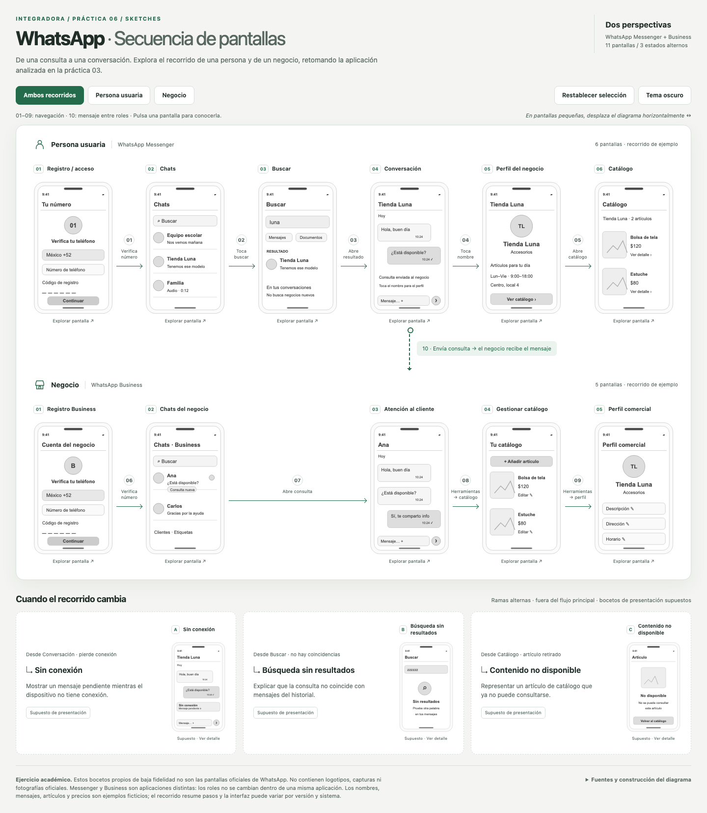

<div align="center">

# Práctica 06 · Secuencia de pantallas de WhatsApp

**Sketches interactivos · Persona usuaria y negocio · Archify**

Integradora · 11 pantallas principales · 3 estados alternos

[**Explorar los sketches en GitHub Pages →**](https://fariasdgs.github.io/Practicas_Integradora_230389/Practica06/)

[Mapa interactivo de Archify](https://fariasdgs.github.io/Practicas_Integradora_230389/Practica06/artifacts/recorridos.archify.html) · [Captura clara](https://fariasdgs.github.io/Practicas_Integradora_230389/Practica06/artifacts/sketches.light.png) · [Captura oscura](https://fariasdgs.github.io/Practicas_Integradora_230389/Practica06/artifacts/sketches.dark.png) · [Captura móvil](https://fariasdgs.github.io/Practicas_Integradora_230389/Practica06/artifacts/sketches.mobile.png)

</div>

## Ver el resultado y las capturas

| Resultado | Enlace en GitHub Pages | Qué encontrarás |
| --- | --- | --- |
| **Sketches interactivos** | [Abrir la práctica](https://fariasdgs.github.io/Practicas_Integradora_230389/Practica06/) | Teléfonos con bocetos propios, paneles de detalle, selección de roles y cambio de tema. |
| **Mapa de navegación en Archify** | [Explorar el mapa](https://fariasdgs.github.io/Practicas_Integradora_230389/Practica06/artifacts/recorridos.archify.html) | Los dos carriles y la consulta que conecta a la persona con el negocio. |
| Sketches · tema claro | [Ver captura](https://fariasdgs.github.io/Practicas_Integradora_230389/Practica06/artifacts/sketches.light.png) | Página completa en tema claro, a 1440 px de ancho. |
| Sketches · tema oscuro | [Ver captura](https://fariasdgs.github.io/Practicas_Integradora_230389/Practica06/artifacts/sketches.dark.png) | Página completa en tema oscuro, a 1440 px de ancho. |
| Sketches · vista móvil | [Ver captura](https://fariasdgs.github.io/Practicas_Integradora_230389/Practica06/artifacts/sketches.mobile.png) | Adaptación a 390 px de ancho con diagrama desplazable. |
| Panel de una pantalla | [Ver captura del detalle](https://fariasdgs.github.io/Practicas_Integradora_230389/Practica06/artifacts/sketches.detail.png) | Propósito, elementos de interfaz, siguiente acción y fuente del perfil del negocio. |
| Sketches · pantalla grande | [Tema claro](https://fariasdgs.github.io/Practicas_Integradora_230389/Practica06/artifacts/sketches.large.light.png) · [Tema oscuro](https://fariasdgs.github.io/Practicas_Integradora_230389/Practica06/artifacts/sketches.large.dark.png) | Capturas de la composición a 2048 px de ancho. |
| Evidencias visuales de Archify | [Abrir galería](https://fariasdgs.github.io/Practicas_Integradora_230389/Practica06/artifacts/recorridos.archify.visual-check.html) | Capturas del mapa en escritorio y en ambos temas. |

**Publicación:** estos enlaces apuntan a la ruta de la práctica en GitHub Pages. Estarán disponibles cuando `Practica06` se incorpore a la rama que publica el sitio y termine el despliegue. Para verla localmente, abre [index.html](index.html); las capturas también están en [artifacts/](artifacts/).

<details>
<summary><strong>Ver una vista previa de los sketches</strong></summary>

[](https://fariasdgs.github.io/Practicas_Integradora_230389/Practica06/)

Pulsa la imagen para abrir la versión interactiva en GitHub Pages.

</details>

## Acerca de la práctica

La página es autocontenida: incluye estilos, lógica, ilustraciones SVG originales y un mapa complementario generado con Archify. Puede abrirse directamente sin servidor ni conexión.

Se retoma WhatsApp de la práctica 03. Los roles se adaptan a **persona usuaria de WhatsApp Messenger** y **negocio que usa WhatsApp Business**, dos aplicaciones distintas. El ejemplo representa una consulta sobre un producto de una tienda ficticia.

## Recorridos

- Persona: registro y verificación → chats → buscar en el historial → conversación → perfil del negocio → catálogo.
- Negocio: registro Business → chats del negocio → atención al cliente → gestionar catálogo → perfil comercial.
- Conexión entre carriles: la consulta enviada por la persona llega a la conversación que atiende el negocio.
- Estados alternos: sin conexión, búsqueda sin resultados y contenido no disponible. Su presentación se identifica como **supuesto**.

El registro resume configuración inicial y verificación. Las transiciones del chat comercial al catálogo y del catálogo al perfil incluyen volver a las herramientas del negocio; las pantallas intermedias se omiten y se explican en el panel.

## Interacción y accesibilidad

Pulsa una pantalla para consultar propósito, elementos, siguiente acción y fuente. Los controles permiten resaltar un rol, cambiar tema y restablecer la selección. Se incluyen botones nativos, `aria-pressed`, texto alternativo, foco visible y soporte de movimiento reducido. Enter abre un boceto, Escape cierra el panel y devuelve el foco a la pantalla seleccionada. El diagrama conserva desplazamiento horizontal en dispositivos pequeños y el documento permite desplazamiento vertical.

Es un ejercicio académico, con wireframes propios en escala de grises. No se emplean logotipos, capturas ni fotografías oficiales. El diseño y los textos de los bocetos no pretenden reproducir exactamente una versión de la aplicación.

## Archify y archivos

Archify no incluye un esquema de teléfonos/sketches. Se usó `workflow` v2 para validar la navegación y se construyó una vista propia de teléfonos para la entrega solicitada. El mapa original se puede abrir desde **Fuentes y construcción del diagrama → Ver mapa base de Archify**, dentro del mismo HTML. Sus controles fijos y su idioma son inglés; la vista principal es español.

| Archivo | Contenido |
| --- | --- |
| [index.html](index.html) | Entrega principal lista para GitHub Pages |
| [VALIDACION.md](VALIDACION.md) | Alcance, resultados y huellas de los artefactos |
| [JSON Archify](artifacts/recorridos.archify.json) | Especificación de navegación |
| [Mapa Archify](artifacts/recorridos.archify.html) | HTML generado por `deliver`, también integrado en la entrega |
| [Comprobaciones de bocetos](artifacts/sketches.check.json) | 37 comprobaciones de navegador y seis tamaños |
| [Comprobaciones Archify](artifacts/recorridos.archify.visual-check.json) | Evidencia automática del mapa complementario |
| [Vista clara](artifacts/sketches.light.png) | Captura de la página completa |
| [Vista oscura](artifacts/sketches.dark.png) | Captura de la página completa |
| [Vista móvil](artifacts/sketches.mobile.png) | Captura a 390 px de ancho |

## Reconstrucción

Desde la raíz del repositorio:

```sh
python3 Practica06/scripts/build.py
```

El constructor requiere el HTML base de Archify ya generado. Para validar o volver a generar ese mapa, sustituye `/ruta/a/archify` por el directorio de la habilidad instalada:

```sh
node /ruta/a/archify/bin/archify.mjs validate workflow Practica06/artifacts/recorridos.archify.json --quality showcase --json
node /ruta/a/archify/bin/archify.mjs deliver workflow Practica06/artifacts/recorridos.archify.json Practica06/artifacts/recorridos.archify.html --quality showcase --json
```

Para repetir la comprobación personalizada, el segundo argumento debe ser un ejecutable Chrome/Chromium compatible:

```sh
node Practica06/scripts/verify.mjs /ruta/a/archify /ruta/al/navegador
```

La página está preparada para publicarse en `/Practica06/`. La rama de trabajo de esta actividad es `practica06`.

## Fuentes oficiales

Consultadas el 14 de octubre de 2026. Las fuentes respaldan funciones generales; las decisiones de composición y el recorrido son una adaptación académica.

- [Registro y verificación](https://faq.whatsapp.com/506595211487528/).
- [Búsquedas en WhatsApp](https://faq.whatsapp.com/1131773267485499/?cms_platform=iphone&locale=es_LA).
- [Mensajería](https://www.whatsapp.com/messaging?lang=en).
- [WhatsApp Business App](https://faq.whatsapp.com/641572844337957).
- [Acerca del catálogo](https://faq.whatsapp.com/405903568419894/).
- [Consultar un catálogo](https://faq.whatsapp.com/494713302702908/).

[← Volver al índice de prácticas](../README.md) · [Consultar la práctica 03](../Practica03/README.md)
